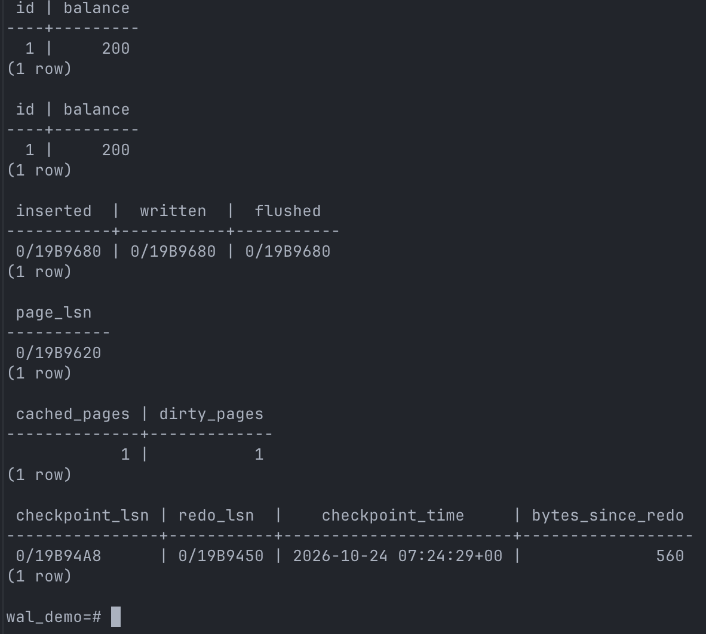
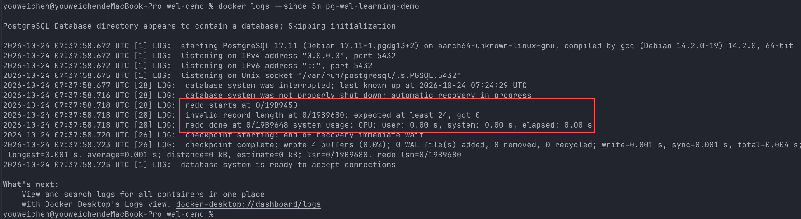
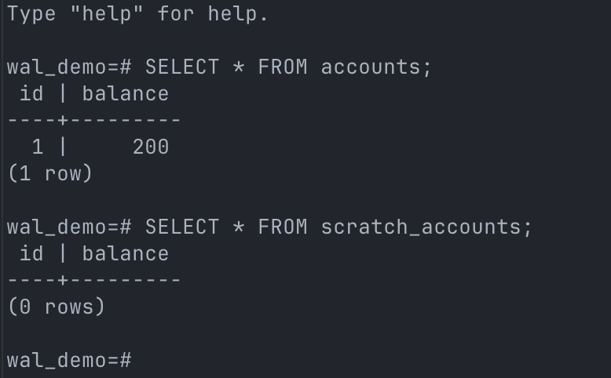
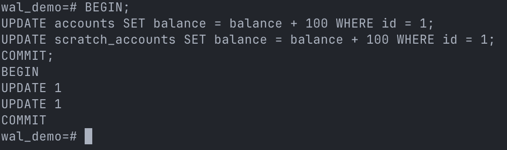
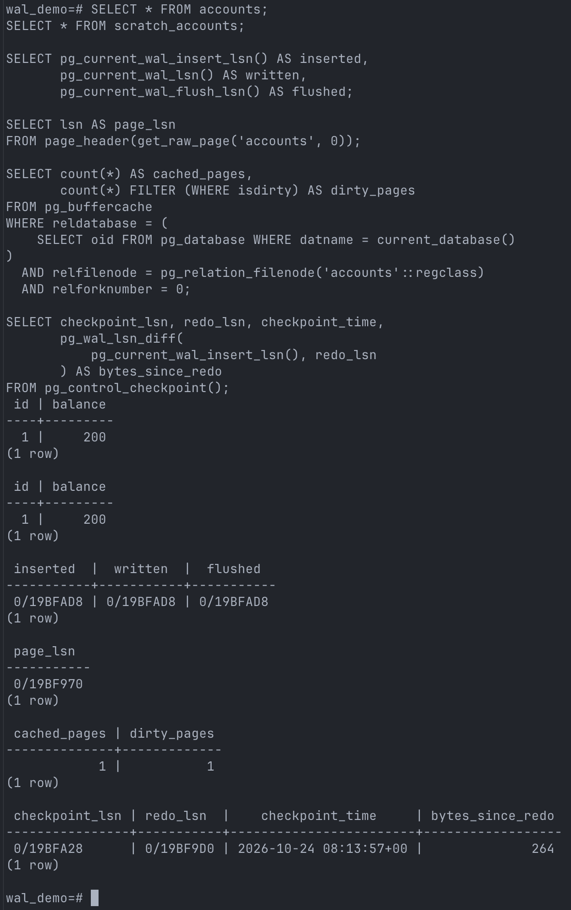
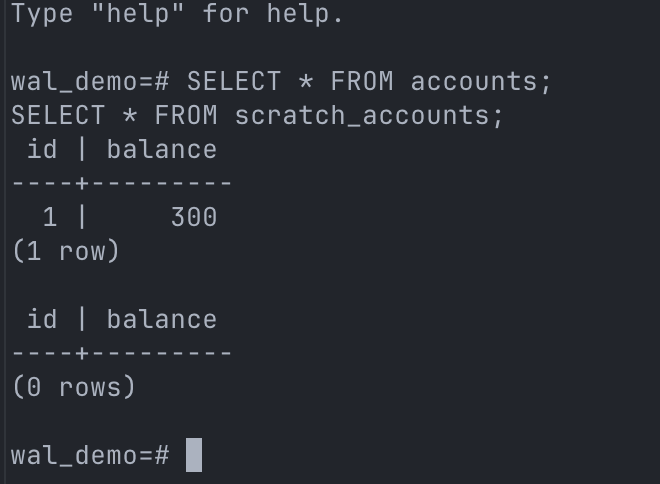

# 动手验证 PostgreSQL WAL：脏页、崩溃恢复与检查点

这篇是 [WAL 原理篇](./postgresql-wal.md)的配套实验。使用 Docker Desktop 和 PostgreSQL 17，无需在 Mac 安装 PostgreSQL。

三个实验分别回答一个问题：

| 实验 | 重点观察 |
| --- | --- |
| 提交后，数据页一定写回了吗？ | 提交成功后是否仍有脏页 |
| 崩溃后，已提交的数据还在吗？ | 恢复日志、普通表与 UNLOGGED 表的结果 |
| 恢复会停在检查点吗？ | REDO 起点变化、检查点之后的提交结果 |

请按顺序执行，后续实验依赖前面的数据。所有操作仅用于下面新建的专用容器，不要连接已有数据库。

## 1. 准备实验环境

### 先分清在哪里输入命令

- **Mac 终端**：输入 `docker ...` 命令，可以在任意目录操作。
- **psql 数据库终端**：看到 `wal_demo=#` 后输入 SQL，语句通常以分号结尾。
- 在 psql 中输入 `\q` 并回车，回到 Mac 终端。不要把 Docker 命令粘贴到 SQL 提示符后。

### 第一步：启动 Docker Desktop

在 Mac 终端执行：

```bash
docker info
```

能看到 Docker 服务端信息后再继续。如果提示无法连接 Docker 引擎，先启动 Docker Desktop。

### 第二步：创建独立的 PostgreSQL 容器

在 Mac 终端完整执行：

```bash
docker run -d --name pg-wal-learning-demo \
  --label local.wal-learning-demo=v1 \
  -e POSTGRES_PASSWORD=wal-demo-local-only \
  -e POSTGRES_DB=wal_demo \
  postgres:17 postgres \
  -c fsync=on \
  -c synchronous_commit=on \
  -c full_page_writes=on \
  -c shared_buffers=128MB \
  -c bgwriter_lru_maxpages=0 \
  -c checkpoint_timeout=1h \
  -c max_wal_size=1GB \
  -c autovacuum=off \
  -c log_checkpoints=on
```

反斜杠表示命令续行，后面不要加空格。首次运行需要联网拉取官方 `postgres:17` 镜像，支持常见 Apple Silicon 和 Intel Mac；主版本固定，补丁版本可能更新。

**如果提示同名容器已存在，停止这一步，不要为了继续而删除未知容器。** 如果是之前创建的本实验容器，可继续已有实验，不要重复初始化表；想从头开始则先阅读 [清理说明](#cleanup)。

### 安全边界

- 使用专用容器名 `pg-wal-learning-demo`；Docker 不会覆盖已有同名容器。
- 不映射主机端口、不挂载 Mac 本地目录、不连接已有数据库。
- PostgreSQL 17 官方镜像的数据目录使用 Docker 匿名卷；杀死或重启同一个容器不会删除该卷。
- 后文的崩溃和清理命令会先校验实验标签，不匹配时拒绝操作。
- 示例密码只适用于这个隔离实验，不能拿来部署生产服务。

为便于观察脏页，实验关闭 autovacuum 和后台写入进程的 LRU 写出，并把自动检查点间隔设为一小时；`fsync`、`synchronous_commit`、`full_page_writes` 保持开启。数据量很小，通常也不会因缓冲区不足而触发写回。

**这些是教学设置，不是生产调优建议，也不能保证脏页始终留在内存中。**

### 第三步：等待数据库就绪

在 Mac 终端执行：

```bash
docker exec pg-wal-learning-demo pg_isready -h 127.0.0.1 -U postgres -d wal_demo
```

看到 `accepting connections` 后再继续；如果尚未就绪，等几秒再执行一次。这里使用 TCP 检查，避开官方镜像初始化期间的临时 Unix socket 服务。如果一直无法就绪，查看：

```bash
docker logs --tail 60 pg-wal-learning-demo
```

### 第四步：进入数据库并初始化

在 Mac 终端执行：

```bash
docker exec -it pg-wal-learning-demo psql -X -U postgres -d wal_demo -P pager=off
```

这会在容器内启动 PostgreSQL 客户端 `psql`，连接 `wal_demo` 数据库，并关闭结果分页。

看到 `wal_demo=#` 后，在 psql 中执行以下 SQL。只在新实验数据库上初始化一次：

```sql
CREATE EXTENSION pg_buffercache;

CREATE TABLE accounts (
    id integer PRIMARY KEY,
    balance integer NOT NULL
);

CREATE UNLOGGED TABLE scratch_accounts (
    id integer PRIMARY KEY,
    balance integer NOT NULL
);

INSERT INTO accounts VALUES (1, 100);
INSERT INTO scratch_accounts VALUES (1, 100);

CHECKPOINT;

SELECT * FROM accounts;
SELECT * FROM scratch_accounts;

SELECT name, setting, unit
FROM pg_settings
WHERE name IN (
    'fsync', 'synchronous_commit', 'full_page_writes',
    'autovacuum', 'bgwriter_lru_maxpages', 'checkpoint_timeout'
)
ORDER BY name;
```

`CHECKPOINT;` 就是手动执行检查点的 SQL。返回 `CHECKPOINT` 表示本次检查点已完成；它不会重置余额，也不是提交事务的替代品。

两张表现在各有一行 `id = 1, balance = 100`，检查点为后续实验建立基线：

| 表 | 类型 | 用途 |
| --- | --- | --- |
| `accounts` | 普通表 | 展示 WAL 支持的持久性 |
| `scratch_accounts` | UNLOGGED 表 | 异常关闭后会被重置为空的对照表 |

UNLOGGED 表不是“可能随机丢几行的普通表”：异常关闭后，整张表会被清空，即使此前执行过检查点也不例外。

如果任何 SQL 报错，先处理错误，不要直接跳到下一节。下面的扩展和控制信息查询使用实验超级用户，不应直接照搬到生产应用账号。

## 2. 实验一：提交后，数据页一定写回了吗？

**要验证：提交不必等待数据页写回。** 重点观察提交成功后，`dirty_pages` 是否仍大于 0。

### 操作

在 psql 中执行一次更新，随后立即观察：

```sql
BEGIN;
UPDATE accounts SET balance = balance + 100 WHERE id = 1;
UPDATE scratch_accounts SET balance = balance + 100 WHERE id = 1;
COMMIT;

SELECT * FROM accounts;
SELECT * FROM scratch_accounts;

SELECT count(*) AS cached_pages,
       count(*) FILTER (WHERE isdirty) AS dirty_pages
FROM pg_buffercache
WHERE reldatabase = (
    SELECT oid FROM pg_database WHERE datname = current_database()
)
  AND relfilenode = pg_relation_filenode('accounts'::regclass)
  AND relforknumber = 0;
```

两张表的余额都从 `100` 变成 `200`。查询中的 `cached_pages` 是普通表主数据分支的缓存页数，`dirty_pages` 是其中尚未写回的脏页数。

### 预期结果与解释

通常会看到余额为 `200`，同时 `dirty_pages = 1`。这说明事务已经提交，但缓冲区中仍有脏页。

下面保留原实验截图作对照，只需关注余额和 `dirty_pages`；其余字段属于后文的进阶观察，不要求输出完全一致。



在本实验的同步提交配置下，<mark style="background-color: #c8e4ff">提交成功意味着所需 WAL 已持久化，**不意味着所有数据页已经写回**</mark>。这里并没有绕过缓存读取数据文件中的旧余额。

### 如果脏页数是 0

页面可能已经被写出，不代表 WAL 失效。可以再执行一次本节的更新并及时观察，但每次都会再加 `100`，下一实验的预期余额也要相应调整。

## 3. 实验二：崩溃后，已提交的数据还在吗？ {#crash-recovery}

**要观察：<mark style="background-color: #fff3a3">普通表保留已提交结果，UNLOGGED 表被清空。</mark>**

接着实验一操作，先不要执行新的 `CHECKPOINT;`。下面会强制终止专用实验容器，不要用于其他数据库。

### 第一步：退出 psql，再模拟崩溃

在 psql 中输入：

```text
\q
```

退出客户端不会停止数据库。回到 **Mac 终端**，完整执行下面的标签检查和崩溃命令：

```bash
if [ "$(docker inspect --format '{{ index .Config.Labels "local.wal-learning-demo" }}' pg-wal-learning-demo)" = "v1" ]; then
  docker kill --signal=KILL pg-wal-learning-demo
else
  echo "不是本实验容器，拒绝执行崩溃操作。"
fi
```

这会对专用容器发送 `SIGKILL`，不给 PostgreSQL 正常停库、执行关闭检查点的机会。**不要用 Docker Desktop 的普通 Stop / Restart 按钮替代它。**

### 第二步：重启原容器

在 Mac 终端执行：

```bash
docker start pg-wal-learning-demo
docker exec pg-wal-learning-demo pg_isready -h 127.0.0.1 -U postgres -d wal_demo
```

如果尚未 `accepting connections`，等待几秒后再单独执行一次 `pg_isready` 检查。这里启动的是**原容器和原数据卷**，不是再次执行 `docker run` 创建新数据库。

查看最近的日志：

```bash
docker logs --since 5m pg-wal-learning-demo
```

根据日志时间确认本次启动，寻找类似片段：

```text
database system was interrupted
... redo starts at ...
... redo done at ...
database system is ready to accept connections
```



### 第三步：重新连接并查询

在 Mac 终端执行：

```bash
docker exec -it pg-wal-learning-demo psql -X -U postgres -d wal_demo -P pager=off
```

然后在 psql 中执行：

```sql
SELECT * FROM accounts;
SELECT * FROM scratch_accounts;
```

如果只执行过一次更新事务，预期是：

| 表 | 崩溃前 | 恢复后 |
| --- | --- | --- |
| 普通表 `accounts` | `balance = 200` | **仍为 `200`** |
| UNLOGGED 表 `scratch_accounts` | `balance = 200` | **0 行，整张表被清空** |



### 结果说明与实验边界

普通表的已提交结果在本次崩溃后得以保留，启动日志也显示实例执行了恢复流程；UNLOGGED 表则按其设计被清空，但这不代表整个实例完全不产生 WAL。

仅凭余额恢复为 `200`，不能证明某一条 UPDATE 的 WAL 一定被应用到了这个页面：页面也可能在崩溃前已经写出。**本实验验证可见结果，不追踪某条 WAL 的具体重放过程。**

Docker 在 macOS 的 Linux 虚拟机中运行。杀死容器进程模拟的是**数据库进程崩溃**，不是主机断电或存储设备故障，不能用这个实验验证硬件刷盘可靠性。

## 4. 实验三：恢复会停在检查点吗？

**要验证：检查点推进恢复起点，但恢复不会停在检查点时的状态。** 先比较恢复起点，再验证检查点之后的提交。

为了让数字容易对照，在当前 **psql 会话**中重置两张实验表。**这会清空这两张表的实验数据，不要用于其他数据库。**

```sql
TRUNCATE TABLE accounts, scratch_accounts;
INSERT INTO accounts VALUES (1, 100);
INSERT INTO scratch_accounts VALUES (1, 100);
CHECKPOINT;
```

现在两张表重新回到 `100`，并建立了新的检查点基线。不需要删除容器。

### 第一步：更新余额，但先不执行新的检查点

在 psql 中执行：

```sql
BEGIN;
UPDATE accounts SET balance = balance + 100 WHERE id = 1;
UPDATE scratch_accounts SET balance = balance + 100 WHERE id = 1;
COMMIT;
```

接着在 psql 中执行以下观察 SQL，保存输出作为检查点前的状态。余额应为 `200`。

```sql
SELECT * FROM accounts;
SELECT count(*) AS cached_pages,
       count(*) FILTER (WHERE isdirty) AS dirty_pages
FROM pg_buffercache
WHERE reldatabase = (
    SELECT oid FROM pg_database WHERE datname = current_database()
)
  AND relfilenode = pg_relation_filenode('accounts'::regclass)
  AND relforknumber = 0;

SELECT checkpoint_lsn, redo_lsn,
       pg_wal_lsn_diff(
           pg_current_wal_insert_lsn(), redo_lsn
       ) AS bytes_since_redo
FROM pg_control_checkpoint();
```



### 第二步：手动执行检查点

仍在 psql 中执行：

```sql
CHECKPOINT;
```

看到返回 `CHECKPOINT` 后，在 psql 中再次观察：

```sql
SELECT * FROM accounts;
SELECT count(*) AS cached_pages,
       count(*) FILTER (WHERE isdirty) AS dirty_pages
FROM pg_buffercache
WHERE reldatabase = (
    SELECT oid FROM pg_database WHERE datname = current_database()
)
  AND relfilenode = pg_relation_filenode('accounts'::regclass)
  AND relforknumber = 0;

SELECT checkpoint_lsn, redo_lsn,
       pg_wal_lsn_diff(
           pg_current_wal_insert_lsn(), redo_lsn
       ) AS bytes_since_redo
FROM pg_control_checkpoint();
```

重点比较 `redo_lsn` 是否前进、`dirty_pages` 是否减少。以下原实验截图还包含额外字段，不影响本节对照：



| 字段 | 检查点前 | 检查点后（本实验基本无并发） |
| --- | --- | --- |
| `dirty_pages` | 通常为 `1` | 通常为 `0` |
| `redo_lsn` | 基线检查点的恢复起点 | 推进到更靠后的位置 |
| `checkpoint_lsn` | 旧检查点记录的位置 | 新检查点记录的位置 |
| `bytes_since_redo` | 从旧起点到当前 WAL 的跨度 | 通常明显缩小，但不必为 `0` |
| `balance` | `200` | 仍为 `200` |

`CHECKPOINT` 自身也会生成 WAL，所以日志位置仍会继续前进。

### 区分两个位置与一个差值

```text
WAL 从左向右增长 →

旧 REDO 起点 …… UPDATE + COMMIT …… 新 REDO 起点 …… 新 checkpoint 记录 …… 后续 WAL
                                       ↑                    ↑
                                    redo_lsn          checkpoint_lsn
```

这是顺序执行时的示意，不是所有并发场景的固定排列。在线检查点期间仍可有新事务产生 WAL。

`bytes_since_redo = 当前 insert LSN - redo_lsn`，表示从恢复起点到当前日志位置的字节跨度，**不是恢复耗时，也不是需要修改的页面数**。实际恢复开销还受 I/O、缓存和记录类型影响。

### 第三步：验证检查点之后的提交仍可恢复

在 psql 中再次执行：

```sql
BEGIN;
UPDATE accounts SET balance = balance + 100 WHERE id = 1;
UPDATE scratch_accounts SET balance = balance + 100 WHERE id = 1;
COMMIT;
SELECT * FROM accounts;
```

此时余额是 `300`。**不要再执行检查点**，按[实验二的崩溃恢复流程](#crash-recovery)再操作一次：

1. 用 `\q` 退出 psql，在 Mac 终端执行带标签校验的 `SIGKILL` 命令。
2. 重启原容器，等待数据库就绪。
3. 重新连接 psql，查询两张表。



普通表应恢复到 **`300`**，而不是上一次检查点时的 `200`；UNLOGGED 表再次变成 0 行。

原因是最后一次增加虽然发生在检查点之后，但已经提交并持久化所需 WAL。检查点提供恢复基线，之后的 WAL 补齐新修改。

> 不要手动删除 `pg_wal` 文件。检查点不代表所有更早的 WAL 都能立即删除；归档、复制槽等仍可能需要它们。

## 进阶观察：WAL 位置与页面 LSN {#lsn}

这一节不影响三个实验的结论，可以跳过。若要执行，请在清理容器之前进行，并保持实验表中有数据。

在 psql 中执行：

```sql
CREATE EXTENSION IF NOT EXISTS pageinspect;

SELECT pg_current_wal_insert_lsn() AS inserted,
       pg_current_wal_lsn() AS written,
       pg_current_wal_flush_lsn() AS flushed;

SELECT lsn AS page_lsn
FROM page_header(get_raw_page('accounts', 0));
```

| 字段 | 含义 |
| --- | --- |
| `inserted` | WAL 已插入到的位置 |
| `written` | WAL 已写入文件的位置，尚不等于可靠持久化 |
| `flushed` | WAL 已持久化到的位置 |
| `page_lsn` | 普通表第 0 页最近一次 WAL 关联修改的位置，不是提交记录的位置 |

三个 WAL 位置可能相同，这是正常的。函数依次采样，不构成全局原子快照。

`get_raw_page()` 通过 PostgreSQL 缓冲区读取页面，不能用它证明磁盘文件中仍保存旧余额；页面 LSN 也不能单独证明事务已提交。

如果想观察一段操作产生的 WAL 跨度，可以在同一 psql 会话中执行：

```sql
SELECT pg_current_wal_insert_lsn() AS before_update \gset

BEGIN;
UPDATE accounts SET balance = balance + 100 WHERE id = 1;
COMMIT;

SELECT pg_wal_lsn_diff(
    pg_current_wal_insert_lsn(), :'before_update'::pg_lsn
) AS wal_bytes;
```

`\gset` 把查询结果保存为 psql 变量，该行不要再加分号。这段操作会让普通表余额再增加 `100`，不要插入主实验流程中执行。

`wal_bytes` 是两个日志位置之间的字节距离，不是修改行数。后台活动也可能产生 WAL，因此它不是这条 UPDATE 的精确成本。

## 5. 清理实验数据 {#cleanup}

如果仍在 psql，先输入 `\q` 退出。

**下面的命令会永久删除专用实验容器和附属匿名卷，实验数据将丢失。** 在 Mac 终端完整执行：

```bash
if [ "$(docker inspect --format '{{ index .Config.Labels "local.wal-learning-demo" }}' pg-wal-learning-demo)" = "v1" ]; then
  docker rm -fv pg-wal-learning-demo
else
  echo "不是本实验容器，拒绝删除。"
fi
```

标签不匹配或容器不存在时不会删除。这里不执行全局 Docker 清理；`postgres:17` 镜像保留，便于下次使用。上述匿名卷清理行为针对本文原样创建的容器；如果自行改成绑定挂载，Mac 本地目录不会被这个命令删除。

## 附录：在 Docker Desktop 中查看实验

打开 **Containers → pg-wal-learning-demo**（标签名可能随版本变化）：

| 入口 | 用途 |
| --- | --- |
| **Logs** | 查看检查点日志和崩溃后的 REDO 恢复日志。 |
| **Files** | 浏览 `/var/lib/postgresql/data/` 下的 `base` 和 `pg_wal`；它们是二进制文件，不要手动修改。 |
| **Inspect** | 查看挂载、标签和端口配置。 |
| **Exec / Terminal** | 进入容器终端，运行下面的客户端命令。 |

```bash
psql -X -U postgres -d wal_demo -P pager=off
```

容器内部不需要再加 `docker exec`。查看余额、LSN 和脏页仍需执行 SQL，Docker Desktop 不会自动把数据文件展示成表格。

## 参考资料

以下资料均对应 PostgreSQL 17：

- [CREATE TABLE：UNLOGGED 表](https://www.postgresql.org/docs/17/sql-createtable.html)
- [pg_buffercache](https://www.postgresql.org/docs/17/pgbuffercache.html)
- [pageinspect](https://www.postgresql.org/docs/17/pageinspect.html)
- [系统管理函数：WAL 与控制信息](https://www.postgresql.org/docs/17/functions-admin.html)
