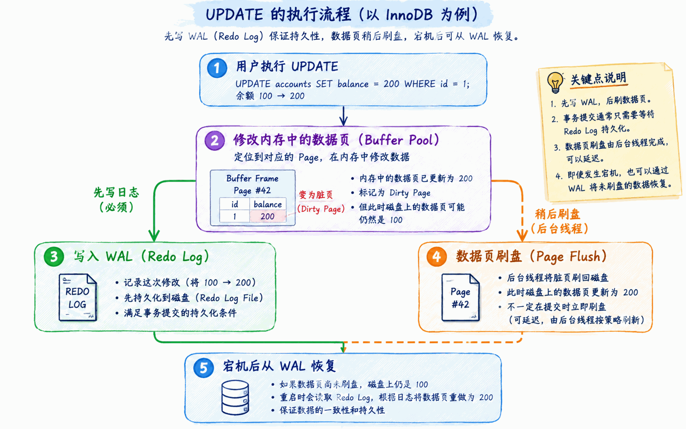

# PostgreSQL WAL：数据页没写回，为什么能提交？

把账户余额从 `100` 改成 `200`，事务提交成功了，但修改后的数据页可能还没有写回数据文件。

**如果这时数据库崩溃，刚才的修改为什么不会丢？**

答案是 WAL：PostgreSQL 可以先把恢复修改所需的日志持久化，再让数据页稍后写回。崩溃后，通过日志恢复尚未写回的修改。

本文沿着一次余额更新，回答三个问题：

1. 修改先发生在哪里？——数据页与共享缓冲区。
2. 日志写到哪里，才能安全提交或写回页面？——WAL 与 LSN。
3. 崩溃后从哪里开始恢复？——检查点。

> 阅读范围：以普通的 WAL 日志化表、开启 `fsync` 的本地同步提交为例，并假设存储设备正确兑现刷盘请求。想亲手验证，可继续阅读[配套实验](./postgresql-wal-lab.md)；特殊配置和实现细节放在文末补充说明中。

## 1. UPDATE 修改的是什么？

### 数据以页为单位存储

以账户表 `accounts(id, balance)` 为例，SQL 展示的是行和列，底层则把记录组织到数据页（Page）中：一个表包含多个页，一个页可以容纳多条记录；索引也有自己的页面。

PostgreSQL 的页面大小通常是 **8 KB**。页面保存记录、页头等结构，而不是 SQL 原文。


### 修改先发生在内存中

访问数据时，PostgreSQL 会把需要的页面加载到共享缓冲区（shared buffers），后续访问可以复用缓存，减少磁盘读取。

例如，执行并提交一次更新：

```sql
BEGIN;
UPDATE accounts SET balance = 200 WHERE id = 1;
COMMIT;
```

假设更新涉及 Page #42，提交后仍可能暂时出现以下状态：

| 位置 | 余额对应的状态 |
| --- | --- |
| 共享缓冲区中的 Page #42 | 已更新为 `200` |
| 数据文件中的 Page #42 | 仍是更新前的 `100` |

这里只示意余额变化，不展开 MVCC 行版本。

内存中已经修改、尚未写回数据文件的页面，称为脏页（Dirty Page）。之后，后台进程或需要回收缓冲区的后端进程可以将它写回。

简单说：**数据页是管理数据的单位，共享缓冲区是缓存这些页的内存区域，脏页是其中修改后尚未写回的页。**

## 2. 数据页没写回，为什么能提交？

### 先让修改可恢复，再择机写回数据页

如果每次提交都等待所有相关数据页持久化，可能产生大量分散写入和同步等待；如果只修改内存而不留下可靠记录，崩溃时又会丢失修改。

WAL（Write-Ahead Logging，预写式日志）把这两件事分开：先持久化恢复所需的日志，让修改可恢复；数据页则可以稍后写回。日志主要以追加方式写入，也便于集中刷盘。



这里要区分两个动作：

- **写入文件**：数据可能仍在操作系统缓存中。
- **持久化（刷盘）**：通过 `fsync` 等机制，确保数据进入可靠的持久化存储。

WAL 的“先写日志”约束的是持久化顺序，并不是要求修改内存之前先把日志刷盘。

### 提交和写回，分别遵守什么规则？

一次更新可以简化为：读取页面 → 修改内存页面并生成 WAL → 生成提交记录并等待所需 WAL 持久化 → 向客户端确认成功。

数据页写回独立于提交过程，不一定发生在提交之后。关键是下面两个约束：

| 什么时候 | 必须先完成什么 | 不必等待什么 |
| --- | --- | --- |
| 写回某个数据页前 | 该页对应的 WAL 持久化 | 页内事务全部提交 |
| 向客户端确认同步提交前 | 包含提交记录的 WAL 持久化 | 所有修改过的数据页写回 |

**事务提交不等于数据页已写回，数据页写回也不等于事务已提交。**

页面可以包含未提交事务的修改；这些修改是否对其他事务可见，由事务状态和 MVCC 等机制控制，而不是由“页面是否写回”决定。

## 3. WAL 记录什么？LSN 表示什么？

### WAL 保存的是恢复信息，不是 SQL 原文

WAL 记录根据类型保存不同的信息，例如事务 ID、数据文件和页面标识，以及重放修改所需的数据。需要时，还会保存整页镜像（Full-Page Image），用于应对页面部分写入等问题。

并非每条 WAL 都是页面修改：事务提交和检查点也有对应的记录。

因此，崩溃恢复不是把 `UPDATE accounts ...` 再执行一遍，而是重放这些恢复信息。

### LSN 是日志流中的位置

LSN（Log Sequence Number）表示 WAL 日志流中的字节位置，例如 `0/16B6C50`。比较两个 LSN，就能知道哪个位置更靠后；它不是事务编号，也不是时间戳。

PostgreSQL 用不同位置表示不同阶段的进度：

```text
生成 WAL → 写入文件 → 持久化
 inserted    written    flushed
```

“已生成”不等于“已持久化”。在复制场景中，还会用 LSN 表示备库接收或重放到哪里。

普通数据页也会保存页面 LSN，标记该页对应的 WAL 进度。写回这个页面之前，必须确保 WAL 已持久化到至少这个位置，这就是 WAL-First 原则。

**LSN 的作用，是让数据库能比较“页面需要的日志进度”和“日志实际完成的进度”。**

## 4. 检查点为什么能缩短恢复？

### 给恢复建立一个更近的起点

WAL 让修改可以恢复，但如果每次崩溃都要扫描很长一段历史日志，启动就会很慢。

检查点（Checkpoint）会把本轮要求写出的页面修改持久化，并记录一个新的恢复起点。这样，下次崩溃就不必从那么早的 WAL 开始处理。

常规在线检查点可以简化为四步：

1. 确定本轮的 REDO 起点，也就是恢复时开始扫描和重放 WAL 的位置。
2. 将本轮要求写出的脏页逐步写回并同步到持久化存储，期间仍遵守 WAL-First 原则。
3. 写入并持久化检查点 WAL 记录，记录中包含 REDO 起点等信息。
4. 更新控制文件 `pg_control`，供下次启动时定位检查点。

检查点不是暂停所有事务、瞬间清空脏页。数据库仍可继续处理修改，因此检查点结束时仍可能有新的脏页。

### 检查点记录的位置，不是恢复起点

这两个位置容易混淆：

| 位置 | 含义 |
| --- | --- |
| `checkpoint_lsn` | 检查点记录本身在 WAL 中的位置 |
| `redo_lsn` | 该记录保存的恢复起点，通常更早 |

所以，“从最近的检查点恢复”更准确地说是：从最近有效检查点记录的 REDO 起点开始恢复。

**检查点是恢复的起跑位置，不是恢复结果的终点。** 数据库还会处理其后的 WAL，恢复后续已提交的修改。

> 不要手动删除 `pg_wal` 文件。即使某段 WAL 已不再用于当前实例的崩溃恢复，归档、复制槽或保留策略等仍可能需要它。

## 5. 崩溃后，余额如何恢复到 200？

回到最初的例子：余额从 `100` 改成 `200`，提交记录已经持久化，但数据文件中的页面仍是旧状态。此时数据库进程崩溃。

重启时，PostgreSQL 会：

1. 读取控制信息，找到最近有效的检查点。
2. 从检查点记录中的 REDO 起点开始扫描 WAL。
3. 重放需要恢复的页面修改；页面 LSN 等信息可帮助判断修改是否已应用，避免重复应用。
4. 恢复事务状态。恢复完成后，已提交修改对相应的新快照可见，未提交修改不会作为已提交结果暴露给用户。

因此，即使数据页在崩溃前没有写回，数据库仍能恢复出余额为 `200` 的已提交结果。

这里既不是重新执行全部 SQL，也不是把未提交修改逐条反向撤销，而是**重放恢复信息，并结合事务状态保证正确的可见性**。

## 6. 记住三件事

- **WAL 提供恢复依据**：在本文的同步提交和可靠刷盘前提下，提交不必等待数据页写回。
- **LSN 标记进度**：用来比较日志生成、写入、持久化，以及页面修改对应的位置。
- **检查点推进恢复起点**：减少要处理的历史 WAL，但恢复仍会继续处理其后的日志。

想把这些概念变成可观察的结果，继续阅读[动手验证 PostgreSQL WAL：脏页、崩溃恢复与检查点](./postgresql-wal-lab.md)。实验分三步验证提交、崩溃恢复和检查点的关系。

## 补充说明：需要时再看

### 哪些情况不适用上述持久性结论？

设置 `synchronous_commit = off` 后，提交确认可以早于 WAL 持久化，崩溃时可能丢失最近已确认的事务。关闭 `fsync` 或存储设备未正确兑现刷盘请求，也会破坏上述可靠性前提。

临时表和 UNLOGGED 表不适用普通表的完整 WAL 保证。特别是 UNLOGGED 表在异常关闭后会被清空，配套实验会展示这一差异。

WAL 是事务持久性（ACID 中的 D）的重要基础；原子性（A）还需要事务状态、MVCC 等机制配合，不能理解为“有日志就能撤销所有未提交修改”。

### 页面与 LSN 的实现细节

- 数据库页不同于磁盘扇区或 SSD 物理页，实际映射由存储系统决定。
- LSN 通常写作 `X/Y`，分别表示一个 64 位位置的高、低 32 位十六进制值。理解主线不需要掌握编码规则。
- 对于需要记录 WAL 且使用标准页头的普通数据页，`pd_lsn` 保存最近一次与该页修改关联的 WAL 记录的结束位置；它不是事务提交记录的位置。

### 检查点相关参数

以下以 PostgreSQL 17 为准。这些参数用于理解检查点行为，不是生产调优建议。

| 参数 | 作用 |
| --- | --- |
| `checkpoint_timeout` | 自动检查点的最大时间间隔，默认 5 分钟 |
| `max_wal_size` | 控制触发自动检查点的 WAL 大小目标，是软限制，实际占用可能超过它 |
| `min_wal_size` | WAL 回收时保留可复用文件的基准，不是触发检查点的下限 |
| `checkpoint_completion_target` | 将检查点写入工作分散到检查点间隔的一定比例内，默认 `0.9`，用于平滑 I/O |

## 参考资料

以下资料均对应 PostgreSQL 17：

- [Write-Ahead Logging](https://www.postgresql.org/docs/17/wal-intro.html)
- [WAL Configuration](https://www.postgresql.org/docs/17/wal-configuration.html)
- [Database Page Layout](https://www.postgresql.org/docs/17/storage-page-layout.html)
- [Asynchronous Commit](https://www.postgresql.org/docs/17/wal-async-commit.html)
