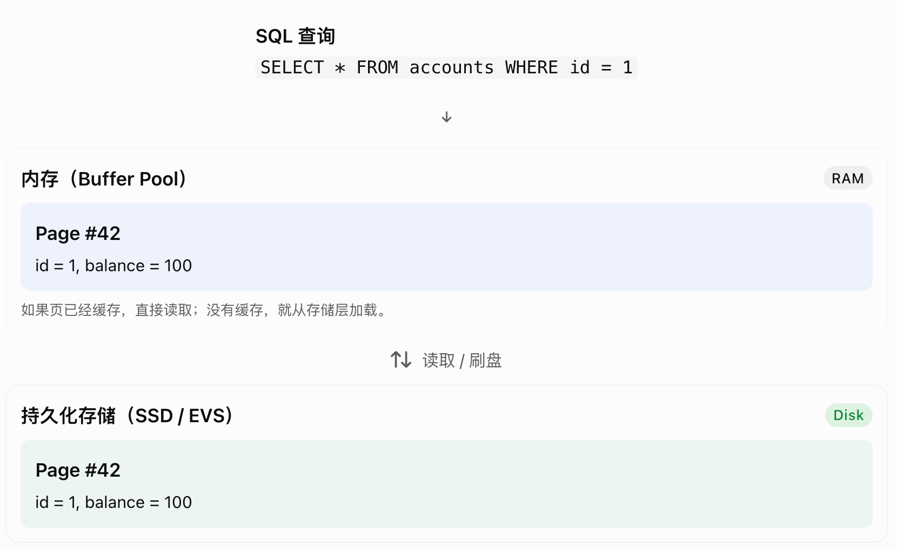
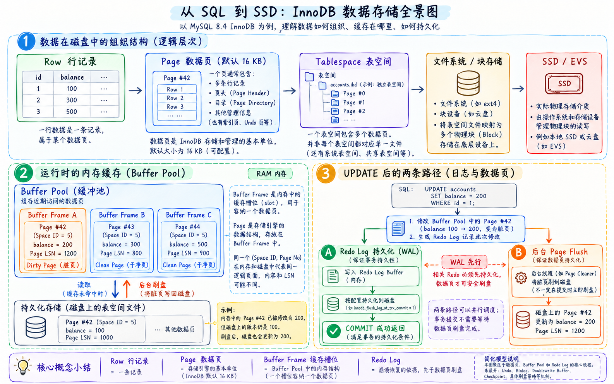
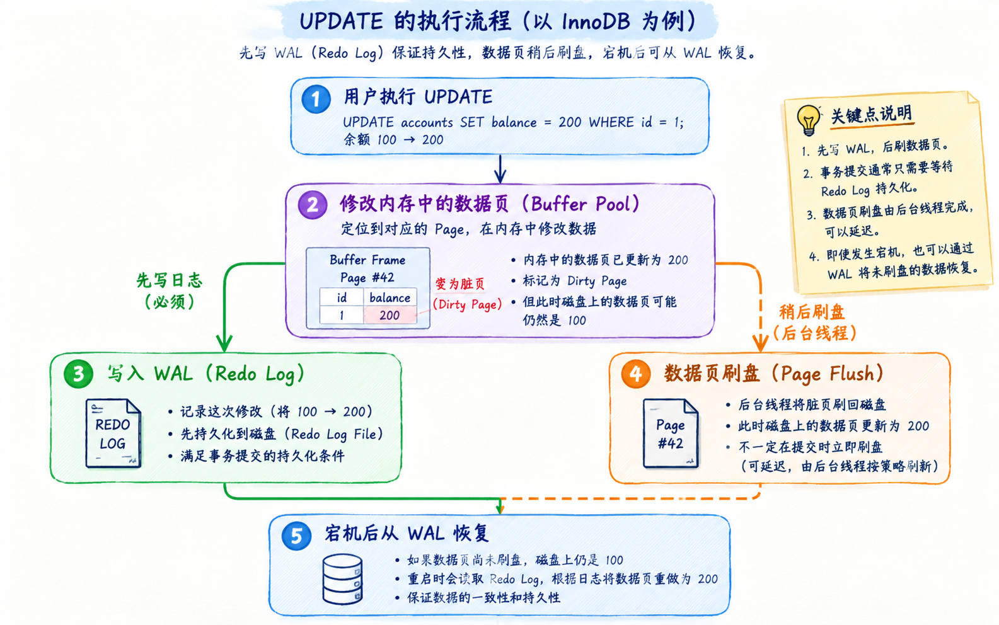

# PostgreSQL WAL 机制：从数据页到崩溃恢复

> **WAL（Write-Ahead Logging，预写式日志）** 的核心规则是：在把修改后的数据页写入数据文件之前，必须先将对应的 WAL 持久化。
>
> 这里的“先写日志”约束的是**持久化顺序**，并不是说修改内存中的数据之前，就必须先把日志写到磁盘。

理解 WAL，可以沿着这条线索展开：**数据页 → 内存缓存与脏页 → WAL 写入顺序 → LSN → Checkpoint → 崩溃恢复**。

## 1. 前置知识：数据如何存储和修改

### 1.1 数据页是什么

假设 PostgreSQL 中有一张账户表：

```sql
CREATE TABLE accounts (
    id integer PRIMARY KEY,
    balance integer NOT NULL
);

INSERT INTO accounts (id, balance)
VALUES (1, 100), (2, 300), (3, 500);
```

从 SQL 的角度看，我们看到的是行和列：

| id | balance |
| --- | --- |
| 1 | 100 |
| 2 | 300 |
| 3 | 500 |

但在底层，数据库通常不会把每一行保存成一个独立文件，而是把记录组织到一个个**数据页（Page）**中。页是数据库组织和管理存储的基本单位之一。

- 一个表可以包含大量数据页。
- 一个表的数据页可以容纳多条记录。
- 索引也有自己的页面，用来保存索引条目等结构。
- 页面保存的是记录、页头等数据结构，而不是原样保存 `CREATE TABLE` 这样的 DDL 文本。



### 1.2 数据页与持久化存储

**持久化存储**是指在进程退出或机器断电后，仍能保留数据的存储介质，例如 HDD、SSD。数据库的数据文件和 WAL 文件都保存在持久化存储上。

PostgreSQL 的页面大小通常是 **8 KB**。作为对照，MySQL InnoDB 的默认页面大小是 **16 KB**，不要把两者混淆。

数据库页面不等于磁盘物理扇区，也不等于 SSD 内部的物理页。例如，一个 16 KB 的 InnoDB 页面，在逻辑扇区为 4 KB 的块设备上，占用的空间相当于 4 个逻辑扇区；实际物理映射由下层存储系统决定，不能据此推断它们在物理上连续。



另外，**写入文件不一定等于已经持久化**：数据可能还停留在操作系统缓存中。数据库需要通过 `fsync` 等机制确保数据真正进入可靠的持久化存储。

### 1.3 内存缓存与脏页

数据页并不是一直驻留在内存中。访问数据时，PostgreSQL 会把需要的页面加载到**共享缓冲区（shared buffers）**，后续访问可以复用内存中的缓存，减少磁盘读取。

> MySQL InnoDB 中类似的缓存称为 **Buffer Pool**。本文后续统一使用 PostgreSQL 的术语。

例如，执行一次更新：

```sql
UPDATE accounts
SET balance = 200
WHERE id = 1;
```

假设这条记录位于 Page #42，修改后可能暂时出现：

| 位置 | balance |
| --- | --- |
| 共享缓冲区中的 Page #42 | 200 |
| 数据文件中的 Page #42 | 100 |

内存中已经修改、尚未写回数据文件的页面，称为 **Dirty Page（脏页）**。之后，它可以由后台写入进程、检查点进程，或需要回收缓冲区的后端进程写回。

**缓冲区是缓存页面的内存区域，页是其中缓存的数据单位。**

## 2. 为什么需要 WAL

如果每次修改都立即把相关数据页持久化，可能产生大量分散的写入和同步等待，性能开销很高；但如果只修改内存、攒一批再写，宕机时尚未持久化的修改就可能丢失。

WAL 把“保证修改可恢复”和“写回数据页”分开：

1. 将修改记录到 WAL，日志主要以追加方式写入。
2. 先保证所需 WAL 已经持久化。
3. 在合适的时机再把脏页写入数据文件。



**只要恢复所需的 WAL 已经持久化，即使数据页还没写回，数据库也能在崩溃后通过重放日志恢复相应修改。**

这是事务持久性（ACID 中的 **D**）的重要基础。原子性（**A**）还需要事务提交状态、MVCC 可见性等机制配合，不能仅理解成“有日志就能撤销所有未提交修改”。

## 3. 一次更新如何通过 WAL 保证持久性

对于普通的、需要记录 WAL 的表，可以把一次更新和提交简化为：

1. **读取页面**：将需要的页面加载到共享缓冲区，或直接使用已有缓存。
2. **修改并记录日志**：修改内存中的页面，生成对应 WAL 记录，页面成为脏页。
3. **提交事务**：生成事务提交记录；在常见的本地同步提交配置下，等待 WAL 刷盘到包含该提交记录的位置，再向客户端确认提交成功。
4. **写回数据页**：相关脏页可以稍后写回，但写回前必须确保对应 WAL 已经持久化。

这里有两个不同的约束：

- **页面写回约束**：数据页写入数据文件之前，对应 WAL 必须先持久化。
- **提交确认约束**：同步提交时，确认成功之前必须持久化相应 WAL，但不必等待所有数据页写回。

因此，**事务提交不等于数据页已经写回，数据页写回也不等于事务已经提交**。页面中可以包含未提交事务的修改，其可见性由事务状态和 MVCC 等机制控制。

> 上述持久性保证假设 `fsync` 等可靠性设置正常，且存储设备正确兑现刷盘请求。设置 `synchronous_commit = off` 后，提交确认可以早于 WAL 持久化，崩溃时可能丢失最近已确认的事务；临时表和 UNLOGGED 表也不适用普通表的完整 WAL 保证。

## 4. WAL 记录与 LSN

### 4.1 WAL 记录包含什么

WAL 记录保存恢复所需的信息。许多记录描述页面修改，但**并非每条记录都是一次页面变更**：事务提交、Checkpoint 等也有对应的 WAL 记录。

根据记录类型，内容可能包括：

- 事务 ID。
- 涉及的数据文件和页面标识。
- 重放修改所需的数据。
- 在需要时记录的整页镜像（Full-Page Image），用于应对页面部分写入等问题。

WAL 不是简单地把执行过的 SQL 原文保存下来。

### 4.2 LSN：日志流中的位置

**LSN（Log Sequence Number）** 表示 WAL 日志流中的字节位置，通常写作 `X/Y`，分别表示一个 64 位位置的高、低 32 位十六进制值，例如 `0/16B6C50`。

它不是事务编号，也不是时间戳，而是定位和比较 WAL 进度的坐标。

对于使用标准页头的数据页，`pd_lsn` 记录最后一次修改该页的 WAL 记录的结束位置。页面写回前，必须确保 WAL 已持久化到至少这个位置，这就是 **WAL-First 原则**。

LSN 还可以用来描述：

- WAL 已生成到哪里。
- WAL 已写入或刷盘到哪里。
- 备库已接收或重放到哪里。

这些位置含义不同，不能把“已生成”直接当作“已持久化”或“已重放”。

## 5. Checkpoint：缩短崩溃恢复的起点

### 5.1 为什么需要 Checkpoint

如果没有定期建立恢复起点，崩溃后就可能需要重放很长一段历史 WAL。

**Checkpoint（检查点）** 通过确保检查点要求的页面修改已持久化，建立一个更靠后的恢复起点，限制崩溃恢复需要处理的日志范围。

### 5.2 Checkpoint 大致做了什么

可以把常规在线 Checkpoint 简化理解为：

1. 确定本次检查点的 **REDO 起点**。
2. 将本次检查点要求写出的脏页逐步写回并同步到持久化存储，同时遵守 WAL-First 原则。
3. 写入并持久化 checkpoint WAL 记录，其中包含 REDO 起点等恢复信息。
4. 更新 `pg_control` 中的检查点信息，供下次启动恢复时定位。

Checkpoint 并不是暂停所有事务、瞬间清空全部脏页。数据库仍可继续处理修改，因此检查点结束时，缓冲区中仍可能存在新的脏页。

还要区分两个位置：

- **checkpoint 记录的位置**：检查点记录本身位于 WAL 的哪里。
- **checkpoint 记录中的 REDO 起点**：恢复时从哪里开始扫描和重放 WAL，通常早于 checkpoint 记录本身。

所以，“从最近的 Checkpoint 恢复”更准确地说是：**从最近有效检查点所记录的 REDO 起点开始恢复**。

### 5.3 Checkpoint 之前的 WAL 能立即删除吗

不能仅凭检查点就判断可以删除。

即使某段 WAL 已不再用于当前实例的崩溃恢复，它仍可能因为归档尚未完成、复制槽或保留策略等原因而需要保留。WAL 的回收还必须满足这些约束。

### 5.4 相关参数

| 参数 | 作用 |
| --- | --- |
| `checkpoint_timeout` | 自动检查点的最大时间间隔，默认通常为 5 分钟。 |
| `max_wal_size` | 控制触发自动检查点的 WAL 大小目标，是软限制，实际占用可能超过它。 |
| `min_wal_size` | WAL 回收时保留可复用 WAL 文件的基准，不是触发检查点的下限。 |
| `checkpoint_completion_target` | 将检查点写入工作分散到检查点间隔的一定比例内；现代版本默认通常为 `0.9`，用于平滑 I/O。 |

具体默认值以使用的 PostgreSQL 版本为准。

## 6. 崩溃后如何恢复

假设账户余额从 `100` 改成 `200`，事务的提交记录已经持久化，但数据文件中的页面仍保存旧值 `100`。此时发生宕机：

1. PostgreSQL 启动时读取控制信息，找到最近有效的检查点。
2. 从检查点记录中的 REDO 起点开始扫描 WAL。
3. 对需要恢复的页面修改进行重放；页面 LSN 等信息可帮助判断某项修改是否已经应用，避免重复应用。
4. 恢复事务状态；完成恢复后，已提交修改对相应的新快照可见，未提交事务的修改不会作为已提交结果暴露给用户。

因此，即使崩溃前数据页没有写回，已持久化的 WAL 仍能支持恢复余额为 `200` 的已提交结果。

这里的关键不是“把所有 SQL 再执行一遍”，也不是“把所有未提交修改逐条反向撤销”，而是**重放恢复所需的信息，并结合事务状态保证正确的可见性**。

## 7. 总结

| 概念 | 解决的问题 |
| --- | --- |
| 数据页 | 数据库以什么单位组织和管理数据。 |
| 共享缓冲区 | 如何缓存页面，减少重复读取和立即写回的开销。 |
| 脏页 | 如何描述已修改但尚未写回的数据页。 |
| WAL | 如何在延迟写回数据页的同时，让修改可以在崩溃后恢复。 |
| LSN | 如何定位日志位置、比较页面和日志的处理进度。 |
| Checkpoint | 如何推进恢复起点，减少需要重放的历史 WAL。 |

一句话串起来：**先在内存中修改页面并记录 WAL，遵守“日志先于数据页持久化”的规则，再借助 LSN 和 Checkpoint 完成可靠且范围可控的崩溃恢复。**

## 参考资料

- [PostgreSQL：Write-Ahead Logging](https://www.postgresql.org/docs/current/wal-intro.html)
- [PostgreSQL：WAL Configuration](https://www.postgresql.org/docs/current/wal-configuration.html)
- [PostgreSQL：Database Page Layout](https://www.postgresql.org/docs/current/storage-page-layout.html)
- [PostgreSQL：Asynchronous Commit](https://www.postgresql.org/docs/current/wal-async-commit.html)
